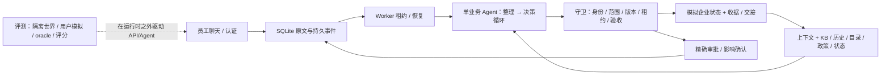

# Employee IT Helpdesk Agent

面向遇到 IT 问题的员工的本地聊天助手。选择账号、应用、连接、权限、跨系统五类问题，因为员工往往同时描述多个目标，信息不全，还涉及当前状态和授权。单次 FAQ 回答不能完成查询、澄清、执行、核查和等待审批；这里由同一个业务 Agent 根据证据选择下一步，程序维护真实状态和执行边界。新输入直接交给模型处理，没有场景 ID 路由。

企业环境是合成数据；认证、审批、确认、写操作、收据、交接和重启恢复是实际程序逻辑。交接仅保存本地记录，不会联系真人。实际 LLM 统一是官方 `deepseek-flash`；embedding 固定 SiliconFlow `BAAI/bge-m3`。

## 启动

支持 Python 3.12+，本机验证版本为 3.12.10；以下命令从仓库根目录运行。Windows PowerShell：

```powershell
py -3.12 -m venv .venv
.venv/Scripts/python.exe -m pip install -e '.[dev]'
# 仅首次配置：已有 .env 时保留它
if (-not (Test-Path -LiteralPath .env)) { Copy-Item .env.example .env }
# 在本地编辑 .env，填写两家 API key；不要提交该文件
powershell -ExecutionPolicy Bypass -File scripts/run_local.ps1
```

打开 <http://127.0.0.1:8000/>。HTTP Host仅允许127.0.0.1和localhost，其他主机名在读取、登录、写入前一律拒绝；没有通配默认值。等价启动命令：

```powershell
.venv/Scripts/python.exe -m uvicorn app.main:create_app --factory --host 127.0.0.1 --port 8000
```

最小运行安装为 `pip install -e .`；`[dev]` 另外安装 pytest 与 Starlette TestClient 所需的 httpx2。应用的供应商客户端继续使用 httpx；没有升级运行时来消除测试警告。可选浏览器工具另装 `pip install playwright`、`python -m playwright install chromium`；文档生成另装 `pip install markdown-it-py beautifulsoup4`。本机浏览器检查使用全局 Python 的 Playwright 1.64.1 和缓存 Chromium 1228；服务进程始终使用项目 .venv。

| 账号 | 用途 |
|---|---|
| alice.sales、bo.remote、chen.data、dana.platform | 不同部门、位置和权限的员工 |
| pat.approver | 精确资源审批，入口 `/approver` |
| dev.debug | 运行 trace、上下文、工具和成本调试，入口 `/debug` |

六个公开演示账号密码均为 `DemoPass123!`。密码是演示数据，真实服务 key 仅由 `Settings.load()` 从 .env/环境加载，不进入浏览器或模型上下文。未配置 DeepSeek key 时模型运行明确失败；embedding 缺失/错误时明确降为关键词检索，不伪造向量或悄悄换模型。

## 演示、重启与重置

新建聊天，输入自己的 IT 问题，继续回答澄清或验证问题。可以尝试“公司电脑的 Okta 账号被锁”“VPN 提示旧会话仍在线”“需要 Grafana 和某个生产库只读权限”，再改变表述或补充信息。生产库需要具体资源和另一个账号的实际批准；在独立浏览器中用 Pat 登录审批，后台自动恢复原员工的原问题。VPN 等有影响操作先显示确认；拒绝/撤销/到期不会变成同意。所有状态以真实卡片和收据为准，模型自由文本仍可能出错。

关闭页面不取消后台处理，重新登录从历史恢复。停止进程后执行相同启动命令即可恢复已保存聊天与事件；硬中断的在途事件等待租约过期，默认最多约 150 秒再认领。重置前先停止服务器：

```powershell
.venv/Scripts/python.exe -m scripts.demo_reset
powershell -ExecutionPolicy Bypass -File scripts/run_local.ps1
```

重置会清空模拟业务聊天、会话、审批、确认和操作并重新种子；不会清空/迁移 `runtime/usage.sqlite`，不会恢复已用额度。业务库是 `runtime/business.sqlite`，检索缓存是 `runtime/retrieval.sqlite`；所有真实模型入口（包括connectivity探针）通过app/config.py的固定路径共享仓库内唯一的累计费用账本，与评测世界数据库分开。

## 架构与边界

继续开发、测试和答辩准备见[开发与测试流程](docs/superpowers/plans/2026-11-02-helpdesk-implementation.md)：模块职责、数据覆盖、最小修改、测试选择与改进依据。设计不要求把所有维度实现到完善，关键路径和取舍需要实际证据支持。



正常用户消息先生成有来源的语义候选，再做工具决策；审批/确认事件直接进入限定原问题的决策阶段。16 个业务工具外，还有受校验的内部 `refine_issue` 和终结 `submit_turn`。账号普通锁定、政策允许的目录权限可直接处理；有影响操作先确认，生产权限先真实审批；超权限、安全禁用、未知且无法安全推进的问题保存完整模拟交接。一个问题解决不关闭其他问题；歧义反馈保留上次验证状态并提示待澄清，不声称全部解决。

五类来源全部提供：22 篇 KB 支持可审核指导，12 条通用历史支持对照，6 个账号的目录绑定身份与设备，8 个服务的健康/变更供现状判断，12 条政策决定实际权限；5 个资源具有精确权限范围。数据在 [data](data)，运行约束在 [app/domain.py](app/domain.py)、[app/tools.py](app/tools.py)，实际模型 Schema 在 [app/contracts.py](app/contracts.py)。设计概念 JSON 与实际字段的差别见[契约对照](docs/04-prompts-and-contracts.md)。

每个事件上限 10 次模型请求、12 次非终结工具、120 秒；整理/决策上下文目标为 10,000/12,000 保守 UTF-8 字节，不是精确 token 数。必需上下文超容量会显式停止。没有证据就不拆成新目标；关系不自动传播解决状态。七项工程裁定及失误代价见[决策记录](docs/engineering-decisions.md)，它们与用户确认的产品选择分开。

## 验证与实际结果

```powershell
.venv/Scripts/python.exe -m pytest -q
.venv/Scripts/python.exe -m evals.runner validate
python scripts/verify_browser.py
python scripts/verify_ui_states.py
python docs/_tools/render_docs.py
```

最终确定性修复检查：**209 个程序测试通过，无警告**；脚本模型 + 实际 Agent/HTTP/浏览器 14 项检查通过；受控时钟另验证到期控件消失与不确定性显示。真实模型 HTTP/浏览器 smoke 在最终边界修复前的 `65743f3` 运行时，用全新输入完成 2 轮、1 次实际模拟解锁、2 个完成运行、0 个事件错误；8 次 DeepSeek 请求约 USD 0.025951501。最终修复后重新启动并离线检查，4 条消息、2 次运行、1 次操作及账本摘要完全一致；没有新模型调用，不将旧 smoke 重标为最终代码的实测。[公开交付证据](docs/delivery-evidence.md)包含实际消息、状态、截图和测试模式。

正式评测与这次 smoke 分开：历史共 66 次真实测量，覆盖 30 个设计槽位，分属多个实现版本。最新**已测**候选 `630e586` 的 17 次/10 案例中，16 次程序模拟有效、12 次满足目标、4 个 Agent 事件错误；1 次运行有 2 个缺失交接标记，8 份历史判断过期/有争议。只有 H01b 有 3 次同候选测量。当前交付的确定性修复没有被重新包装成“最终 30 案例通过”。同模型 grader v4 仅有程序测试，5/6 实测校准属于 v3。[完整实测报告](docs/evaluation-report.md)、[原始可见失败](evals/public/failure-examples.md)、[脱敏机器证据](evals/public)均保留失败和版本。

检索小样本：35 条有答案查询，lexical 命中 26/35，hybrid 35/35；5 条无答案均正确返回空。真实 D01/D05 两模式各 2/2 程序目标通过，样本太小，不能推出普遍优势；没有做两阶段对单阶段消融或真人专家盲评。

截至交付 smoke 的累计保守估算 **USD 2.634129369 / 759 请求**，未结预留 **0**，原 USD 3 内余 **0.365870631**。Task5 本身仍为 **656 请求 / USD 2.295008760**，评测结束快照保留。所有费用为 token 估算，非供应商账单；embedding 费用不属于此 DeepSeek 账本，不声称零成本。新演示会继续消耗余额，达到额度停止；不可通过重置或换目录绕过。付费评测 CLI 必须从仓库根目录运行，例如 `python -m evals.runner live --cases D01 --mode llm_user --output fresh-name`，仍使用共享账本；完整历史原件保存在本机忽略的 `evals/results/`，源码包包含公开脱敏投影。

## 局限与后续

模型可能误解范围、生成错误措辞或非法协议；严格状态守卫不能证明自然语言语义。短事件限额和必需上下文容量可能提前中断，失败时保持已发生动作和进度。规则用户覆盖有限，同模型评分存在共享偏差，合成小样本不代表企业分布。正式测量并未覆盖当前交付的全部 30 案例；`65743f3` 的 smoke 只验证一个正常账号路径；当前边界修复仅做程序/HTTP/浏览器离线验证。界面保留原文，实际样本出现字面 `\n` 以及英文目标标题，未作自动改写。跨聊天个人记忆、完整传播仿真、专家接续、真实企业 API/SSO/ITSM 尚未实现。

更多时间优先提高语义/协议稳定性，补齐同一最终版本的失败复测和重复覆盖，再引入独立专家标注；之后增加 SSO、外部幂等/对账和受认证专家回流。完整理由和扩展条件保留在[设计入口](docs/index.html)、[系统设计](docs/01-system-design.md)、[评估设计](docs/02-evaluation.md)、[答辩与扩展](docs/03-defense-and-extensions.md)、[实现状态](docs/implementation-status.md)。原题逐条映射见[交付核对](docs/delivery-evidence.md)。
