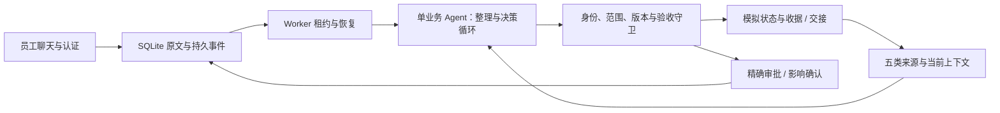

# Employee IT Helpdesk Agent

帮助员工处理账号、应用、连接、权限和跨系统 IT 问题的本地聊天助手。员工常把多个目标放在一句话里，还缺少环境信息；一次 FAQ 回答无法完成查询、追问、操作和核查。这里由一个业务 Agent 根据当前证据选择下一步，程序负责身份、授权、持久状态和真实执行边界。新问题直接交给模型，没有场景 ID 路由。

**先看当前结果：** [员工交互迭代](docs/delivery-iteration-result.md)保留 v6 七案和 v7 两案的全部成功与失败；当前 v7 仅复测 D05/D09，两案程序目标满足。它仍有追问对应不齐、回复冗长和会话键外露的问题。[演示指南与真实模型录屏](docs/demo.md)展示当前版本的一条正常路径。[历史评测](docs/evaluation-report.md)另存 66 次混合版本测量，不代表最终版本 30 案例通过。

企业数据和反馈是合成的；登录、审批、确认、工具写入、收据与重启恢复由实际程序执行。交接保存上下文和接收团队队列，不会联系真人或表示真人已接单。所有 LLM 角色固定官方 `deepseek-flash`，embedding 固定 SiliconFlow `BAAI/bge-m3`。源码可在 [GitHub](https://github.com/Yaliang-Cai/ithelper-project) 阅读，应用仅运行于本机 loopback。

## 运行

Python 3.12+，本机验证 3.12.10。在仓库根目录运行（Windows PowerShell）：

```powershell
py -3.12 -m venv .venv
.venv/Scripts/python.exe -m pip install -e '.[dev]'
if (-not (Test-Path -LiteralPath .env)) { Copy-Item .env.example .env }
# 在本地 .env 填写两家 API key，保留已有配置，不提交凭据
powershell -ExecutionPolicy Bypass -File scripts/run_local.ps1
```

打开 [本地应用](http://127.0.0.1:8000/)。等价命令：

```powershell
.venv/Scripts/python.exe -m uvicorn app.main:create_app --factory --host 127.0.0.1 --port 8000
```

演示密码均为 `DemoPass123!`。员工账号为 `alice.sales`、`bo.remote`、`chen.data`、`dana.platform`；`pat.approver` 处理精确资源审批，`dev.debug` 查看运行轨迹与费用。没有 DeepSeek key 时模型明确失败；embedding 不可用时明确降为关键词检索，不伪造向量或切换模型。最小运行安装为 `pip install -e .`，`[dev]` 增加离线测试依赖。

新建聊天后可以输入自己的问题，回答追问，并检查每个问题的状态和收据。例如账号锁定、VPN 旧会话、Grafana 或指定生产库只读权限。审批须在另一个浏览器用 Pat 登录；后台恢复原员工的原问题。有影响操作使用确认卡，聊天里的“可以”不替代实际确认。

关闭页面后可从历史恢复；停止进程再用同一命令启动即可恢复数据。在途事件等待原租约到期，默认最多约 150 秒。需要清空演示业务时先停服务，再运行 `python -m scripts.demo_reset`；它会删除聊天、审批和操作记录。**重置不会恢复模型额度。** 业务库为 `runtime/business.sqlite`；全部模型入口始终使用仓库内唯一 `runtime/usage.sqlite`，累计硬上限 USD3。已有项目余量很少，演示前检查[最新费用证据](docs/demo.md)，不要把历史余额当作可用余额。

## 工作方式与取舍



模型负责理解、查证和选择工具；后端决定操作能否发生、状态是否足以结案。普通本人账号锁定和政策允许的目录权限可直接处理；VPN 重置先确认，生产权限先审批；安全禁用、超权限或无法安全推进的问题保存交接材料。目标分别跟踪，一个问题解决不会关闭其他问题。成功意味着有实际效果或正确的等待/交接状态，并向员工说明当前进展；不把一次工具调用直接等同于员工已恢复。

五类合成来源互补：22 篇 KB 给出可审核操作指导，12 条通用历史提供对照，6 个账号的目录绑定身份与设备，8 个服务的健康/变更说明现状，12 条政策约束权限；另有 5 个精确资源。数据见 [data](data)，实现与协议见 [app](app)、[契约说明](docs/04-prompts-and-contracts.md)。

选择 SQLite 和模拟企业接口使行为可重现、可检查收据，也限制了外部系统真实性。两阶段单 Agent 便于保存多目标状态，没有额外的运行时路由模型；每事件限 10 次模型请求、12 次非终结工具和 120 秒。上下文按保守 UTF-8 字节限额整理，必需证据超容量会停止。这些边界控制成本和副作用，不能证明模型理解正确。[设计与七项工程裁定](docs/engineering-decisions.md)解释理由、风险和扩展条件。

## 验证

```powershell
.venv/Scripts/python.exe -m pytest -q
.venv/Scripts/python.exe -m evals.runner validate
```

当前完整离线套件 **214 passed**，普通检出与精确 Git LF 源码树均通过，案例结构检查 **31 个变体**。其中 5 项新增回归验证历史密封校验的 LF/CRLF 可移植性与内容变化拒绝；应用仍为 v7。GitHub Actions 在 Python 3.12 执行同样的安装、测试与结构验证，不需要 API key，不调用付费模型。[首次托管失败与修正](docs/delivery-evidence.md)另列，实际托管结果见[工作流运行记录](https://github.com/Yaliang-Cai/ithelper-project/actions/workflows/checks.yml)，本地测试不能替代该结果。另有脚本模型驱动真实 Agent/HTTP/浏览器的 14 项检查、受控时钟 UI 的 3 项检查；模式和复现方式见[演示指南](docs/demo.md)。程序测试不证明自然语言质量。

真实模型评估使用独立合成业务世界、用户模拟、程序 oracle 和独立上下文评分。v6 七案中有未完成、无效用户模拟、被拒绝评分以及为保留演示费用而停止的运行；v7 仅针对两个已知失败复测，D09 通过实际确认 API 保存一次重置收据。D05 尚未验证等待后的问答，D09 仍有长回复与内部会话键。两案单次结果不能推出普遍可靠性；同模型 grader 也不能替代人工评审。

历史检索小样本中，有答案查询 lexical 26/35、hybrid 35/35，无答案 5/5 正确返回空；真实 D01/D05 两模式各 2/2 目标满足。样本有限，没有两阶段消融或真人盲评。原始失败、分母和版本边界保留在[完整实测报告](docs/evaluation-report.md)、[公开证据](evals/public)、[集成记录](docs/delivery-evidence.md)。费用均为保守 token 估算，非供应商账单；embedding 另计。

## 局限与后续

模型仍会误解范围、违反协议或生成不合适措辞。界面保留原始回复；后端守卫不能消除语义错误。合成数据、小样本和规则用户不足以代表企业分布；当前版本没有完整 30 案例复测。未接入真实 SSO/企业 API/ITSM、真人专家接续或跨聊天个人记忆。

更多时间先补同一最终版本的失败与重复覆盖，核对可见问题和结构化问题，再用独立专家标注评估语义质量；之后接入 SSO、外部幂等/对账和受认证专家回流。详见[系统设计](docs/01-system-design.md)、[评估设计](docs/02-evaluation.md)、[答辩与扩展](docs/03-defense-and-extensions.md)和[原题逐项映射](docs/delivery-evidence.md)。
