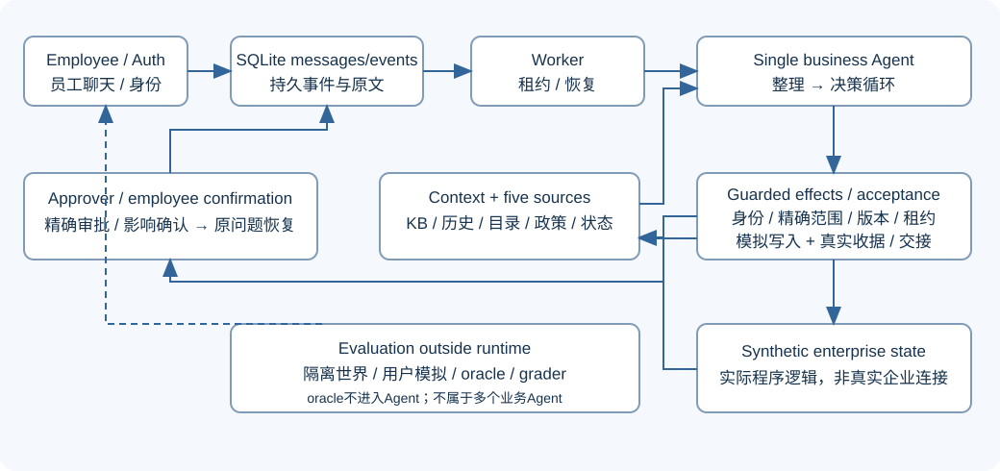

# IT Helpdesk Agent 文档入口

[根README：安装、账号、运行与边界](../README.md)。源码与脱敏证据随仓库分享；应用仅在本机运行。

当前入口：[演示指南与真实模型录屏](demo.md)、[员工交互迭代结果](delivery-iteration-result.md)。当前 v7 仅复测 D05/D09；以下历史报告保留各自版本与费用快照。

继续开发先读[开发与测试流程](superpowers/plans/2026-11-02-helpdesk-implementation.md)：当前代码职责、校验归属、数据覆盖、按变更选测试、自然交互验收和提升依据。它替代旧的未勾选任务清单，原计划可从 Git 历史查阅。

1. [实现状态](implementation-status.md)：当前行为、默认值、费用和限制。
2. [真实评测报告](evaluation-report.md)：历史版本、实际模式、分子/分母、失败与未测。
3. [集成交付证据](delivery-evidence.md)：新输入真实HTTP/browser smoke、重启、原题逐项映射。
4. [七项工程裁定](engineering-decisions.md)：理由及判断错误代价，与用户确认产品选择分开。
5. [系统设计](01-system-design.md)：需求、架构、状态、来源、政策与执行。
6. [评估设计](02-evaluation.md)：30设计槽位、驱动器、断言、评分和实验口径。
7. [答辩与扩展](03-defense-and-extensions.md)：选择依据与未实现扩展。
8. [提示词与契约](04-prompts-and-contracts.md)：实际提议Schema示例、阶段职责和语义局限。

设计文件保留选择理由和扩展条件，当前接口与预算已按代码校对；输入摘录和设计目标不代表已通过成绩。HTML来自Markdown，入口index.html。可选文档工具：pip install markdown-it-py beautifulsoup4，然后从仓库根执行python docs/_tools/render_docs.py。原题见[候选题目](../agentic_ai_take_home_candidate_instructions_v20260421_01.html)。
