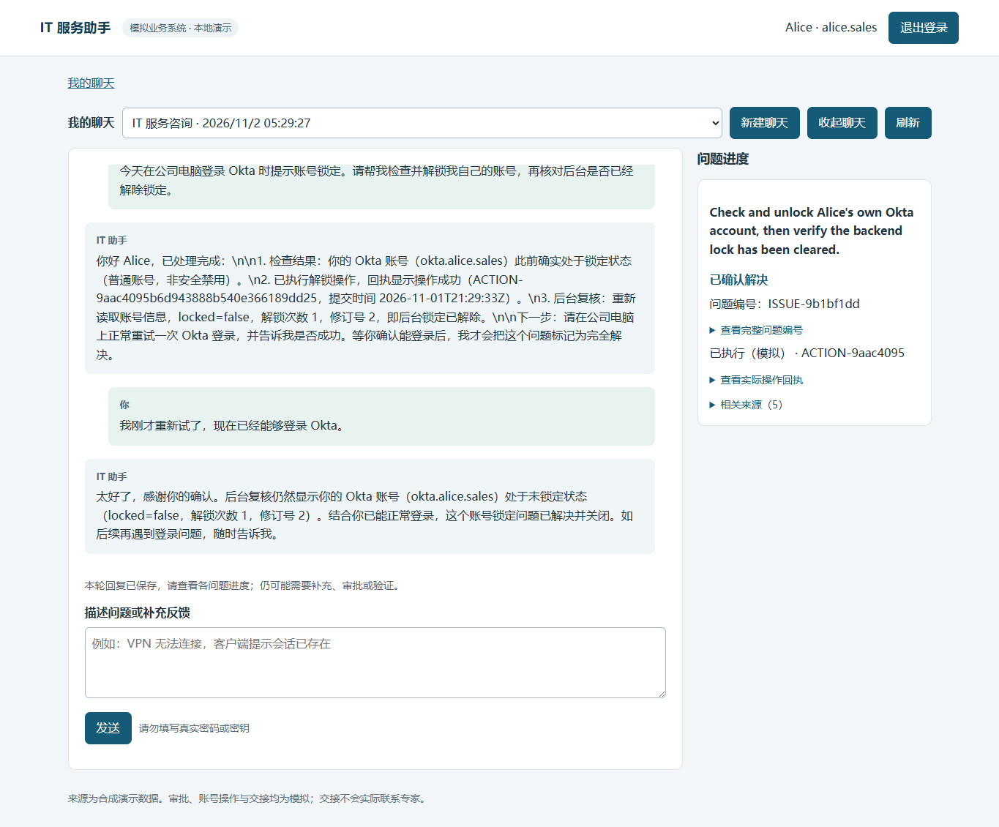

# 本地集成交付证据

2026-11-02（Asia/Shanghai）。本页保留 65743f3 的集成检查与随后边界修复的离线验证；正式评测仍为历史版本测量，没有真人专家或真实企业系统。源码现随 GitHub 仓库分享，应用仍仅在本机运行。

新增 v6 `5055722` 的七次定向实测及最终 v7 `baca519` 的 D05/D09 配对检查另见[员工交互迭代结果](delivery-iteration-result.md)、[v6 证据](evidence/delivery-iteration-v6.json)和[v7 证据](evidence/delivery-iteration-v7.json)。这是单独的新证据，含未完成、无效模拟和评测余量停止；不替换本页旧 smoke 或正式历史汇总，最终 v7 不继承 v6 的五类覆盖。

当前 v7 的[真实模型 UI 录屏与讲解](demo.md)、[消息与费用](evidence/demo-v7-recording/demo-v7.json)、[本次重启核对](evidence/task2-restart.json)独立保存；不覆盖下面的历史 smoke、截图或费用快照。

## 0.1.1：托管 CI 的换行可移植性修正

[首次 GitHub Actions](https://github.com/Yaliang-Cai/ithelper-project/actions/runs/41360433415) 在 Ubuntu 26.04 / Python 3.12.15 安装成功，pytest 为 **1 failed / 208 passed（30.51 秒）**，结构验证未执行。失败来自历史 holdout 密封校验直接比较文件字节：原密封使用 CRLF，Git LF 检出内容相同但哈希不同；10 个案例仅恢复 CRLF 后均匹配原密封，没有事实变化。

修正仅在测试内接受原始精确字节或统一 LF 到历史 CRLF 的换行转换，不进行 JSON 重序列化，也不容忍事实、空白、BOM、混合换行或裸 CR 变化。新增 5 项回归；普通检出 **214 passed（24.28 秒）**，逐文件核对原始 Git blob 的 LF 源码树 **214 passed（24.48 秒）**，两边均验证 31 个案例变体。原 209 项历史记录不改写，应用 v7、案例、oracle、密封值和媒体未变，无新增模型调用。

该托管日志还提示 `setup-python@v5` 的 Node 20 兼容警告；仅改为官方 [setup-python v6](https://github.com/actions/setup-python/releases/tag/v6.0.0) 的 Node 24 版本，实际 runner 2.338.2 满足其最低 2.327.1。`checkout@v6` 和 Python 依赖不变。源码包版本为 0.1.1，修正版仍须发布后取得实际托管 CI 结果；本地测试通过不替代该检查。

## 原交付的实际检查

| 检查 | 模式与结果 | 证据/复现 |
|---|---|---|
| 安装 | Python3.12.10，`pip install -e '.[dev]'`成功，pip check无冲突 | 最小运行安装`pip install -e .`；可选浏览器/录屏工具见[演示指南](demo.md)，文档渲染工具见[文档入口](README.md) |
| 程序回归 | 203 passed in23.33s，无warning；实际临时SQLite/认证/政策/Agent，外部模型fixture | `.venv/Scripts/python.exe -m pytest -q`；不等于语义成功率 |
| API不确定性 | 先KeyError失败，补显式safe DTO后通过 | `tests/test_api.py -k uncertainty`；仅source_message_id/candidate_issue_ids |
| 显示回归 | 实际JS+fixture HTTP+受控时钟，先复现过期按钮保留，修复后3项通过 | `python scripts/verify_ui_states.py`：闲置到期删除确认控件；模糊反馈显示最后验证状态及待澄清；明确后移除提示 |
| 浏览器 | scripted_model_real_agent_http_browser，14项通过，0付费调用 | `python scripts/verify_browser.py`；本机runtime/browser/20261101T212831Z保存截图/trace/日志 |
| 新输入真实模型 | 2用户轮，2completed live_agent运行，1unlock操作，5非终结工具，8模型请求，0事件错误 | [实际消息/状态/回执](evidence/delivery-smoke.json)；两运行model_calls5/3、tool_calls4/1 |
| 停止/重启 | 实际HTTP：4消息/2运行/1动作及内容摘要、账本完全相同，无新增调用 | [前后摘要](evidence/restart.json) |
| 重置 | 默认业务库离线重新种子，账本字节不变；回归保留已结费用和未结预留 | `python -m scripts.demo_reset`、tests/test_delivery.py；smoke后未清空记录 |
| 其他检查 | eval validate31具体变体（30槽位+H01b）、compileall、node --check、pip check、diff --check通过 | 全部不调用付费模型 |

另建全新runtime/setup-venv，以最小`pip install -e .`安装成功、pip check无冲突；该环境实际启动loopback8001并通过health/演示登录/空聊天检查后停止，项目账本完全未变。文档9个本地HTML通过链接/标题/表格/JSON示例检查；Chromium实际检查导航、架构SVG加载、实测报告与交付页可达、390px无横向溢出，并查看截图。首次临时文档检查把标题“评估”写成“评测”，修正断言后通过；不是应用/文档导航故障。

交付前扫描152个tracked artifacts：两家已配置真实key的精确匹配0，长API token/Bearer模式匹配0；仅打印路径/数量，没有输出凭据。.env被忽略，runtime/.venv/.superpowers均无tracked内容。扫描发现旧协调报告曾被跟踪，已仅从Git索引移除，本机原件保留，公开评测/决策记录保留实质证据。

Starlette1.10.0 TestClient优先加载httpx2，旧httpx路径发出弃用warning。按[官方说明](https://www.starlette.io/testclient/)补dev可选依赖httpx2>=2,<3，本机2.16.0；`python -W error -c "from fastapi.testclient import TestClient"`通过。运行时httpx0.28.1保留，未为此升级FastAPI/Starlette或屏蔽warning。

## 真实smoke范围

开发助手通过浏览器输入全新自然语言，无场景ID/用户模拟器/grader/oracle。实际登录、CSRF、持久事件/worker、DeepSeek Flash、业务效果与卡片共同运行。初始驱动在异步新建聊天后过早读取选项，取得空聊天ID，轮询收到列表后报TypeError；首条消息已保存且继续执行。修正驱动等待选项，在同一个聊天恢复，没有重发首条消息或重复解锁。公开JSON中recovered_browser_driver=true，不声称脚本一次无中断完成。

第一轮查询本人Okta普通锁定、政策允许、实际解锁并复查；模型请求试登录。第二轮输入“我刚才重新试了，现在已经能够登录 Okta。”，再次查询后resolved。后台unlock_count=1、revision=2。用户反馈属于合成环境的开发者输入，不能证明真实Okta登录。此路径实际来源directory/policy/tool_receipt，没有搜索KB/历史，不声称新增hybrid检索实测。embedding仅固定配置；检索证据见历史报告。

桌面和390px截图实际查看，无横向溢出，手机聊天区可滚动。模型原文有字面`\n`和英文目标标题；按textContent安全保留，没有自动改写。

[手机截图](evidence/employee-mobile.png)。本次65743f3记录的服务<http://127.0.0.1:8000/>；当时启动PID41816，stdout/stderr为runtime/delivery/app-restart.stdout.log、app-restart.stderr.log。PID随重启变化。

## 费用与版本

smoke前USD2.608177868/751请求/0预留；增量USD0.025951501/8请求；之后USD2.634129369/759请求/0预留，原USD3内余USD0.365870631。未换模型、增加额度、迁移或清零runtime/usage.sqlite。重启/离线检查无新增费用；估算不是供应商账单。

Task5自身仍为656请求/USD2.295008760，结束快照保留。生成器现使用evals/task5-cost-snapshot.json固定Task5截止快照，后续评测费用与current_project_ledger另列，不吸收后续demo或新评测。冻结版本/原文不改写。65743f3（最终边界修复前）smoke精确runtime SHA256在[JSON](evidence/delivery-smoke.json)，正式最新已测仍630e586；[metrics](../evals/public/metrics.json)列当前代码差异。新增smoke不是正式30案例复跑。

历史66次live测量跨版本；最新候选17次/10案例，16程序有效、12满足目标、4事件错误、1次有2个必需交接缺失标记。8份旧判断过期/有争议；5/6实测校准属于grader v3，v4仅程序验证。[完整实测](evaluation-report.md)、[失败原文](../evals/public/failure-examples.md)保留未测和反例。

## 原题逐项映射

对照[原始题目](../agentic_ai_take_home_candidate_instructions_v20260421_01.html)，以下实现不等于所有语义能力达标。

| 题目部分 | 交付与证据 | 限制 |
|---|---|---|
| Problem Framing：用户/交互 | 员工、多轮Web，根README和smoke | 非坐席工作台 |
| 直接解决/升级边界 | 自有普通账号/目录权限；影响确认、生产审批、保存交接 | 无真实专家联络 |
| 数据/用途 | 五来源data与系统设计 | 本smoke只用目录/政策/回执 |
| 成功体验 | 每目标独立核查，实际状态/反馈/审批 | 两分钟为题目示例，不保证所有请求 |
| 交接上下文 | facts/hypotheses/attempts/evidence/open_questions/team，实际ID | 专家接续未实现 |
| What We Are Looking For：对话诊断 | 持久追问、有限语义类别、缺范围澄清 | 模型仍可能误解 |
| 多步推理/工具 | 单Agent动态选择16业务工具与内部细化，真实trace | 无场景诊断分支 |
| 状态/记忆 | 独立问题、纠正、持久事件与重启证据 | 当前聊天，无跨聊天个人检索 |
| 解决/交接判断 | 执行/验收分开，交接按问题生命周期幂等 | 历史重复交接失败仍保留 |
| 可靠性 | 已知歧义暂停相关写入，协议/容量/工具/费用有界停止 | 非全部语言歧义覆盖 |
| 安全/guardrails | Auth/CSRF/归属/精确范围/版本/租约/到期/撤销/幂等 | 自由措辞不能完全程序证明 |
| 评估 | 规则/LLM用户、程序断言、同模型grader、检索对照 | 无真人盲测，不池化版本成功率 |
| 生产思考 | trace、持久费用预留、worker恢复、loopback、来源版本 | 外部对账/SSO为扩展 |
| README：问题/为何Agent | 根README开头，多目标和动态证据/授权 | 不只是FAQ查询 |
| README：架构/边界/来源 | 架构图、四设计文件、data和工具目录 | 企业系统合成 |
| README：假设/权衡 | 七工程裁定、短预算/当前聊天/语义局限 | 未证明两阶段准确性提升 |
| README：运行 | Python、安装、.env、账号、URL、重置、重启 | 浏览器/文档依赖独立可选 |
| README：评估 | 命令、实际模式、分版本数字和原失败 | 当前交付非最终30全通过 |
| README：更多时间 | 稳定性/同版本复测/独立标注/SSO/外部对账 | 见答辩与扩展设计 |
| Code/Demo/Optional design note | 可运行源码、本地git archive、新输入演示、四设计材料 | 不发布/push；包不含本机数据库/密钥/协调scratch |

## 设计与可执行契约

单Agent、五场景/来源、真实模拟效果、独立多目标、审批恢复、lexical降级均实现。默认10模型/12非终结工具/120秒、10k/12k保守字节；增加guarded refine_issue。新目标来自员工请求，不因证据机械拆分。小语义匹配阈值属于开发样本启发式，不是通用语义验证；必需上下文不足停止。已知模糊反馈保留每目标上次验证，all_resolved=false且页面待澄清。概念JSON不能保证原样用于请求，实际以app/contracts.py、tools.py、main.py为准。四设计文档保留理由、历史目标和未实现扩展。

## 最终整体审查后的确定性修复（2026-11-02）

整体审查记录2项Important和2项Minor，本次逐项落实：connectivity改用所有真实模型入口共同引用的app/config.py canonical ledger，项目配置显式从仓库.env加载，RUNTIME_DIR/CWD只影响业务/输出、不分配新预算；预算已耗尽/overrun时探针在任何供应商请求前停止。API最外层Host校验只允许127.0.0.1/localhost，无通配部署默认值；攻击者匹配Host+Origin也在读取/登录/写入前400。报告开头区分已完成的旧smoke与当前修复，历史Task5费用固定快照并单列后续评测。

新增离线回归先4failed/2passed，修复后相关41passed；最终全程序209passed in23.66s，无warning。真实程序/脚本模型浏览器14checks、受控时钟3checks均通过，零付费。固定历史Task5仍656请求/USD2.295008760；合成“后续新批次”的回归证明截止值不变而新费用另列。正式测量/原oracle不改写。

原docs/evidence/delivery-smoke.json及其原始runtime哈希、两截图和restart.json字节保留：它测量65743f3，在当前config/main.py确定性修复之前。metrics.integration_smoke.matches_current_runtime现为false并列差异，当前没有新的live模型实测；不把旧成功路径重新贴到新HEAD。当前UI/服务加载已通过离线浏览器历史读取，未发送新消息。

只停止经命令行核实的原app启动进程，再以隐藏loopback helper启动相同factory。新实际服务器PID8388，启动helper PID43028；URL仍http://127.0.0.1:8000/，日志runtime/delivery/final-fix-app.stdout.log、final-fix-app.stderr.log。正常localhost/127.0.0.1读取200；任意匹配Host+Origin的读取/health/登录/建聊天/入队请求全部400。消息4/事件2/运行2/动作1及内容摘要、759条账本行指纹完全一致；花费USD2.634129369、预留0、剩余USD0.365870631，未新增付费调用。

[最终离线边界与重启证据](evidence/final-boundary-checks.json)记录模式、前后摘要、Host状态和进程。四项修复已通过定向复核，无新增阻断问题；交付 ZIP 从最终已提交源码生成，并核对文件内容与凭据排除。

## 开发材料一致性审校

后续审校统一了开发流程、实际接口和预算单位，修正幂等机制、检索切分/无匹配、时钟与未实现交互的描述。文档区分现有能力、验收目标和扩展，数据强调正反例及实体关系，改进强调失败依据与同版本证据。离线检查验证 5 个 JSON 示例，其中 3 个通过实际严格 Schema，核对 5 个接口和源数据数量；31 个案例的引用检查通过，生成的 9 页 HTML 通过结构与链接检查。此修订没有运行新的付费测量，历史成绩与语义局限沿用原记录。
